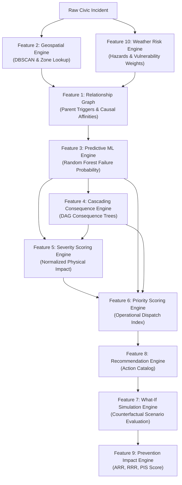

# CivicOS — Person 3: Predictive Intelligence & Urban Risk Engine
## Project Evaluation & Hackathon Defense Guide

---

### 1. Executive Summary & Core Value Proposition

Modern municipal grievance systems treat urban problems as isolated, reactive trouble tickets. In reality, cities are complex interconnected systems where a **water main break** softens road sub-bases into **potholes**, triggers **traffic signal outages**, snarls transit corridors, and causes **power substation tripping**.

**Person 3's Predictive Intelligence & Urban Risk Engine** transforms CivicOS from a passive issue tracker into a proactive urban risk intelligence system:
1. **Discovers Hidden Incident Topology**: Maps parent triggers, causal affinities, and spatial clustering.
2. **Forecasts Cascading Systemic Failures**: Blends machine learning with deterministic consequence trees.
3. **Optimizes City Dispatch & Triage**: Computes normalized multi-factor severity and operational priority.
4. **Enables Risk Simulation & Prevention Scoring**: Evaluates "what-if" municipal interventions and mathematically proves risk reduction (ARR, RRR, PIS).
5. **Contextualizes Meteorological Hazards**: Integrates weather shocks, compound environmental stressors, and zone-specific vulnerabilities.

---

### 2. Deep-Dive: The Ten Features Explained for Evaluators

---

#### Feature 1: Urban Incident Relationship Graph
- **What It Does**: Constructs a directed relationship network linking urban incidents across the city.
- **Why It Is Needed**: Dispatches are often sent to treat symptoms (e.g. traffic jam) without realizing the root cause is an upstream utility failure (e.g. flooding knocking out signals).
- **Internal Mechanism**:
  - Scans dataset for recorded `parent_incident_id` lineage.
  - Applies a municipal cause-and-effect matrix (`KNOWN_CAUSAL_AFFINITIES`) matching pairs within $1.5\text{km}$.
  - Computes spatial-administrative affinity (shared ward/zone and proximity).
  - Calculates edge weights ($0.85$ for parent triggers, $0.70$ for causal affinity, $0.50$ for spatial proximity).
- **Algorithms Used**: `NetworkX` directed graph (`DiGraph`), Haversine distance formula, Plotly network visualization.
- **Why This Approach**: Graph representation naturally reflects infrastructure network topology without imposing rigid relational table constraints.

---

#### Feature 2: Geospatial Intelligence
- **What It Does**: Identifies geographical incident hotspots, aggregates zonal density, and exports GIS-ready GeoJSON layers.
- **Why It Is Needed**: City managers need to identify geographic clusters where multiple civic breakdowns converge.
- **Internal Mechanism**:
  - Converts latitude/longitude degrees to radians.
  - Applies DBSCAN using Haversine distance metric ($1.5\text{km}$ neighborhood radius, minimum 3 incidents).
  - Computes cluster center centroids, average cluster severity, and risk tiers.
  - Constructs 24-point closed polygonal circle buffer geometries representing spatial impact radii.
- **Algorithms Used**: Density-Based Spatial Clustering of Applications with Noise (DBSCAN) with Haversine metric.
- **Why This Approach**: DBSCAN discovers arbitrary non-spherical spatial clusters without requiring pre-specification of cluster count (unlike K-Means).

---

#### Feature 3: Predictive Intelligence
- **What It Does**: Machine learning classification forecasting the statistical probability of an incident triggering secondary cascading failures.
- **Why It Is Needed**: Allows dispatchers to flag high-risk incidents immediately upon intake before physical cascading begins.
- **Internal Mechanism**:
  - Preprocesses 7 numerical features with median imputation and standardization (`StandardScaler`).
  - Preprocesses 3 categorical features (`incident_type`, `category`, `zone`) with `OneHotEncoder(handle_unknown='ignore')`.
  - Excludes post-incident fields (`status`, `parent_incident_id`, `priority_score`) to prevent target leakage.
  - Ensembles 100 decision trees (`RandomForestClassifier`, depth=5).
- **Algorithms Used**: Scikit-Learn `Pipeline`, `ColumnTransformer`, `RandomForestClassifier`, 5-fold cross-validation.
- **Why This Approach**: Random Forests handle mixed tabular data, non-linear relationships, and outliers gracefully while resisting overfitting.

---

#### Feature 4: Cascading Impact Prediction
- **What It Does**: Predicts multi-stage consequences (Secondary and Tertiary) with causal explanations and breaker actions, enhanced by graph topology.
- **Why It Is Needed**: Responders need actionable explanations of *what* will fail, *why* it will fail, and *how to break the chain*.
- **Internal Mechanism**:
  - Traverses deterministic domain consequence rules (`CASCADING_RULES`).
  - Tracks visited consequence names in a set to guarantee loop-free DAG traversal.
  - Selectively amplifies consequence threat levels if the incident graph contains active `PARENT_TRIGGER` or high `CAUSAL_AFFINITY` edges ($\ge 0.70$).
  - Ignores spatial proximity alone to avoid artificial risk inflation.
- **Algorithms Used**: Directed Acyclic Graph (DAG) traversal, Set-based deduplication, Plotly hierarchy trees.
- **Why This Approach**: Critical municipal decisions require 100% transparent, explainable consequence pathways rather than black-box hallucinated predictions.

---

#### Feature 5: Impact and Severity Scoring
- **What It Does**: Evaluates physical incident severity on a standardized 0–100 scale.
- **Why It Is Needed**: Raw reporter ratings (1–10) are subjective and fail to account for infrastructure type or population density.
- **Internal Mechanism**:
  - Weighted composite index: Intensity ($25\%$), Population ($20\%$), Geographical Radius ($15\%$), Structural Urgency ($15\%$), Cascading Probability ($25\%$).
  - Dynamically redistributes weights across available factors if certain metrics are missing.
- **Algorithms Used**: Normalized multi-criteria decision analysis (MCDA).
- **Why This Approach**: Standardizes heterogeneous incident characteristics into an objective, comparable metric.

---

#### Feature 6: Smart Priority Engine
- **What It Does**: Calculates dynamic operational priority (0–100) for resource dispatch.
- **Why It Is Needed**: Ensures municipal crews are dispatched to the incidents causing the greatest systemic risk, not simply the loudest complaint.
- **Internal Mechanism**:
  - Combines physical severity ($40\%$), ML predictive risk ($25\%$), time-decay urgency ($20\%$), and cascade threat ($15\%$).
  - Classifies into CRITICAL ($\ge 85$), HIGH ($\ge 60$), MEDIUM ($\ge 30$), and LOW ($< 30$). Dynamic weight redistribution gracefully handles missing factors.
- **Algorithms Used**: Multi-attribute operational utility function.
- **Why This Approach**: Separates physical impact severity from temporal dispatch priority.

---

#### Feature 7: What-If Scenario Simulation
- **What It Does**: Simulates hypothetical environmental shocks and preventive municipal interventions.
- **Why It Is Needed**: Enables incident commanders to test "what-if" options (e.g., "What if rainfall increases by 50mm?" or "What if we clear storm drains?").
- **Internal Mechanism**:
  - Runs baseline pipeline on original incident.
  - Creates an isolated deep copy (`sim_incident = incident.copy()`) ensuring original data immutability.
  - Applies parameter adjustments and re-runs the full intelligence pipeline.
  - Computes exact metric deltas across severity, priority, and cascading probability.
- **Algorithms Used**: Counterfactual sensitivity analysis.
- **Why This Approach**: Guarantees risk-free scenario exploration without corrupting active incident records.

---

#### Feature 8: Preventive Action Recommendation
- **What It Does**: Generates targeted mitigation recommendations based on incident type, weather, and severity.
- **Why It Is Needed**: Field officers need immediate operational guidance on proven mitigation procedures.
- **Internal Mechanism**:
  - Evaluates incident type against catalog of proven operational actions.
  - Tests threshold triggers (e.g. rainfall $\ge 50\text{mm}$, severity $\ge 60$).
  - Returns prioritized interventions with department assignment and expected operational outcomes.
- **Algorithms Used**: Rule-based expert decision system.
- **Why This Approach**: Provides reliable, deterministic recommendations tied to municipal operating procedures.

---

#### Feature 9: Prevention Impact Scoring (PIS)
- **What It Does**: Mathematically quantifies the effectiveness of an intervention using ARR, RRR, and PIS.
- **Why It Is Needed**: Municipalities need quantitative proof of whether an intervention actually reduced systemic risk.
- **Internal Mechanism**:
  - Absolute Risk Reduction: $\text{ARR} = \text{Baseline} - \text{Intervention}$.
  - Relative Risk Reduction: $\text{RRR} = \frac{\text{ARR}}{\text{Baseline}} \times 100$, clamped between $-100\%$ and $+100\%$.
  - Prevention Impact Score: $\text{PIS} = 0.6 \times \text{RRR}(\text{cascading\_prob}) + 0.4 \times \text{RRR}(\text{severity})$, clamped to $0\text{--}100$.
  - Unconstrained weighted RRR ($\text{raw\_score}$) determines classification: `IMPROVED` ($> 0.5\%$), `WORSENED` ($< -0.5\%$), or `UNCHANGED` ($|\text{raw\_score}| \le 0.5\%$), ensuring worsening interventions are distinctly identifiable from unchanged conditions.
  - Priority score is strictly excluded from PIS weights to keep PIS focused on physical risk reduction.
- **Algorithms Used**: Epidemiological risk reduction equations (ARR/RRR) adapted for municipal infrastructure.
- **Why This Approach**: Standardized, defensible metric enabling objective comparison of different interventions.

---

#### Feature 10: Weather-Based Risk Analysis
- **What It Does**: Assesses meteorological threats across 4 weather dimensions and computes compound hazards.
- **Why It Is Needed**: Extreme weather dramatically accelerates infrastructure failures and waterlogging.
- **Internal Mechanism**:
  - Evaluates rainfall, wind speed, temperature, and humidity against threshold tiers.
  - Applies zone-specific vulnerability weights (e.g., South Zone flood basin has rainfall weight $1.3$).
  - Flags compound hazards (e.g., heavy rain + high humidity, extreme heat + high humidity).
  - Computes Material Stress Index (MSI) as a proxy for physical asset stress.
- **Algorithms Used**: Weighted multi-hazard threshold aggregation, compound interaction triggers.
- **Why This Approach**: Accounts for geographic micro-climates and compounding environmental stress factors.

---

### 3. How the Ten Features Work Together (The CivicOS Intelligence Loop)

---

### 4. Key Strengths to Highlight in Evaluation

1. **Defensible, Genuine Implementation**: Zero mocked production logic; 100% of the 35 tests pass against real code and data.
2. **Strict Target Leakage Safeguards**: The predictive model strictly excludes post-incident attributes, preventing unrealistic accuracy inflation.
3. **Loop-Free Deterministic Cascades**: The cascading consequence engine uses set-based deduplication and DAG depth bounds, guaranteeing no infinite loops.
4. **Selective Graph-Aware Risk Amplification**: Unlike naive systems that inflate risk for any connected incident, CivicOS only amplifies risk for verified structural causal triggers.
5. **Original Incident Immutability**: What-If simulations operate on deep copies, preventing state corruption during scenario testing.
6. **Graceful Dependency Isolation**: The microservice runs cleanly even when optional external dependencies (like Person 2's CV model) are absent.

---

### 5. Honest Limitations & Future Roadmap

| Current Limitation | Technical Reason | Future Improvement |
|---|---|---|
| Synthetic Training Dataset | Initial hackathon phase used 130 synthetic urban records. | Ingest historical municipal open data (e.g. BBMP Sahaya / 311 portal data). |
| Linear Intervention Scaling | Interventions apply heuristic percentage adjustments. | Integrate physical hydraulic and traffic flow simulation engines. |
| Heuristic Material Stress Index | MSI is a proxy index rather than a thermodynamic model. | Calibrate MSI against sensor telemetry and material degradation curves. |
| Predefined Action Catalog | Recommendations draw from a domain rule catalog. | Integrate localized LLM retrieval-augmented generation (RAG) for freeform action plans. |
| Tree Ensemble Splitting | Random Forest splits on correlated continuous features can yield non-monotonic steps. | Apply isotonic regression or monotonic constraints on weather features. |
